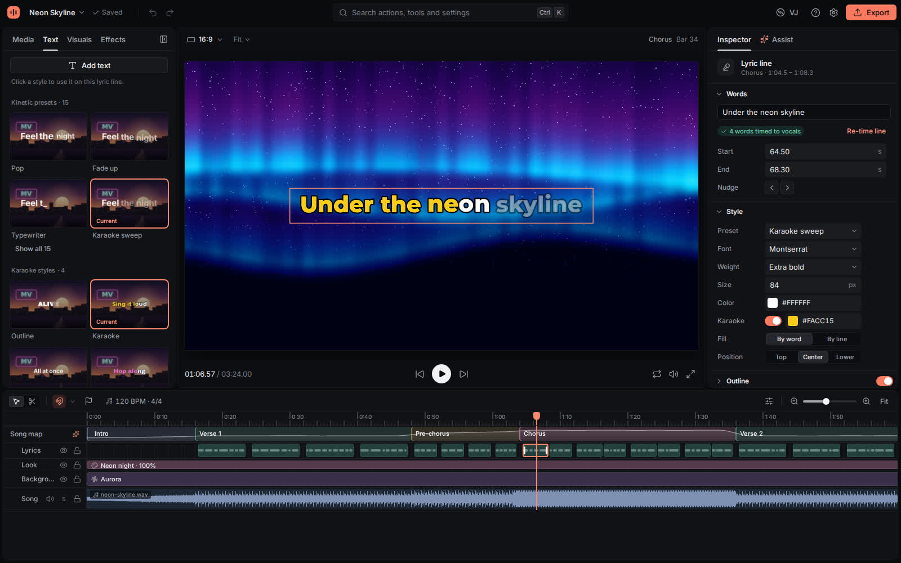
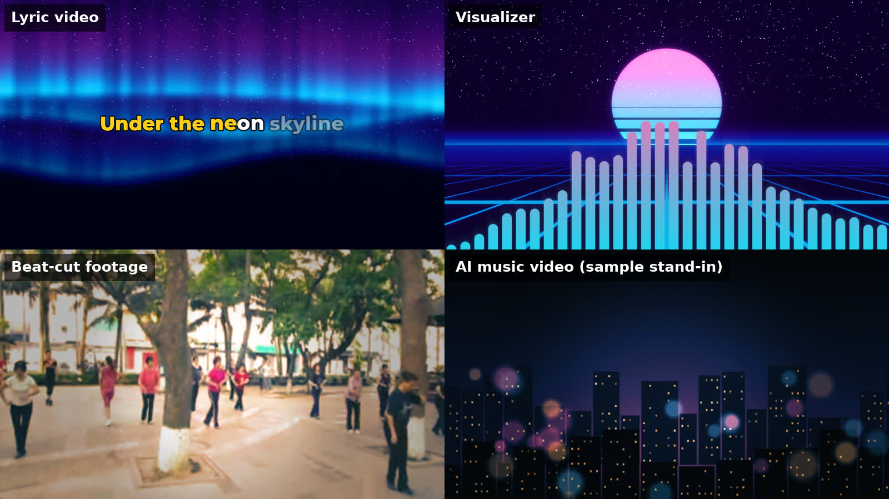
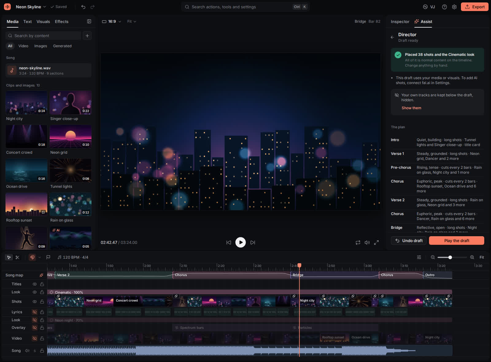
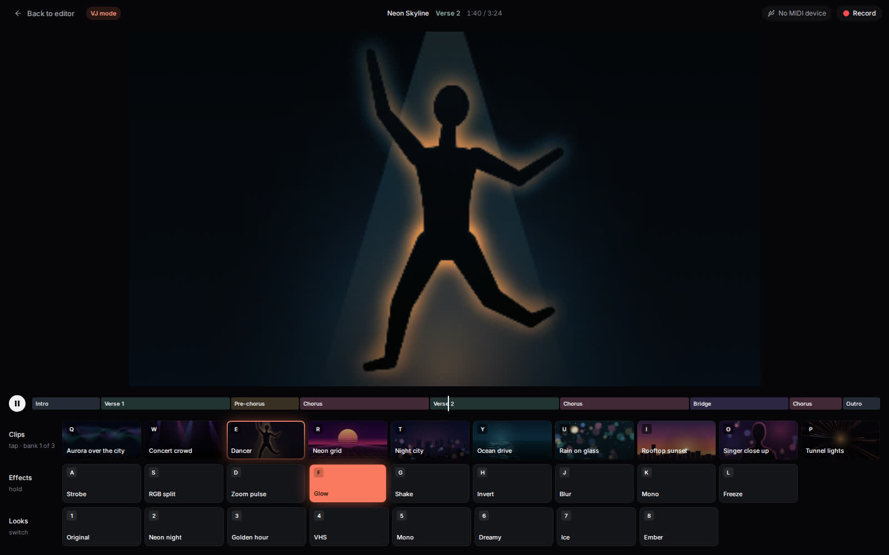

# MV Studio

MV Studio turns a song into a finished music video in your browser. Make a lyric video, a music-reactive visualizer, your own footage cut to the beat, or an AI-generated music video, and keep full manual control over every clip, keyframe, word and effect.

**Open it:** https://theoi.github.io/mv-studio/ (latest desktop Google Chrome or Microsoft Edge)

> **Saving.** Projects save automatically in your browser. To keep a copy of your own, click the project name at the top left and choose **Download project file**. For what the automatic and AI features can get wrong, see [Known limits](#known-limits).



## What you can make

| Kind                 | What it is                                                                                                                                    |
| -------------------- | --------------------------------------------------------------------------------------------------------------------------------------------- |
| **Lyric video**      | Your lyrics, timed to the vocals word by word, with kinetic typography and karaoke highlighting over footage, stills or visuals.              |
| **Visualizer**       | Spectrum, waveform, particle and shader visuals that move with the song's loudness, beats and bass.                                           |
| **Beat-cut footage** | Your own clips, cut automatically to the beats and sections of the song, ready to fine-tune by hand.                                          |
| **AI music video**   | The AI director drafts a whole video from the song and an optional prompt. With a fal.ai key it can also generate the images and video clips. |

The Start screen has a starting point for each kind, plus a blank project and **Open project file**. Every automatic or AI result becomes normal project content (clips, keyframes, text and effects) that you can change by hand. Nothing is locked in.



_The beat-cut frame is “Chinese fitness dancing in Haikou People's Park” by Anna Frodesiak (CC0, Wikimedia Commons), cut to the sample song. The AI music video frame comes from the built-in sample project, whose shots are drawn stand-ins: with your fal.ai key, the director generates real shots in their place._

## Local-first and private

- **No account and no server.** MV Studio is a static web page. Your projects and imported media are stored in your browser's own storage on your computer.
- **AI runs on your computer.** Beat and tempo detection, song sections, stem separation, lyric timing, subject cutout, depth and footage tagging all run in the browser. Each model downloads once and then works offline. MediaPipe, the library behind subject cutout, click-to-select and auto-reframe, would also send Google usage statistics (which of its tasks ran and how fast); MV Studio blocks them.
- **Your media never leaves the browser** unless you use a cloud feature that needs it. fal.ai receives your prompts, plus the image or audio you choose for image-to-video or cloud transcription. An LLM endpoint receives text only: a summary of the song analysis, the lyrics, clip names, footage tags and your request.
- **Cloud features are optional** and use your own keys. Keys stay in this browser and are sent only to the service they belong to.

## Features

### Start and import

- Bring in a song (MP3, WAV, FLAC, M4A/AAC, OGG, Opus), video (MP4, MOV, WebM, MKV), images (PNG, JPEG, GIF, WebP, AVIF, SVG), fonts (TTF, OTF, WOFF, WOFF2) and LUT files (.cube). A song's title and artist tags name the project and the director's title card.
- Drag media from the Library onto the timeline, or drop files from your computer onto a track. They land at the time you drop them, on that track when it has room and takes that kind of media, otherwise on a new track. A locked track takes nothing.
- Open a recent project, duplicate one, or open a project file. A short guide shows you around the editor on your first visit.

### Edit

- Multi-track timeline with the song's waveform: move, trim, split, snap, zoom, multi-select, copy and paste, and markers. Reorder tracks, and mute, solo, lock or hide them.
- Clip speed, and how each clip fills other aspect ratios: following the subject, fitted with bars, or cropped to the center.
- Text with fonts and styling, transitions, keyframe animation, blend modes, color adjustments and filters.
- Your own LUTs in the **Color grade** effect: its LUT choice ends with **Load a LUT file…** (a .cube file or a Hald CLUT image), and once one is loaded, **Manage LUT files…** shows how many color grades use each one and removes it.
- Keyframes show as marks on the selected clip. Click one to go to it, choose its easing (Linear, Ease in, Ease out, Ease in and out or Hold) or remove it. In the Inspector, a value's diamond adds a keyframe at the playhead or removes the one there, and Alt+K (⌥K on a Mac) does the same for the value that has focus.
- Real-time preview in sync with the song: loop a section, set the volume, zoom or go full screen, and move, scale and rotate the selected clip with handles on the canvas.
- Undo and redo with an edit history, autosave, and a portable project file.
- The command palette (Ctrl+K, or ⌘K on a Mac) finds commands by name, and many have a keyboard shortcut. Press **?** to see them, or open **Settings › Shortcuts**.

### Music-aware tools

- Tempo and beats within seconds. Bar starts follow after a further analysis of about a minute. The timeline's beat grid and ruler follow the detected beats and bar starts. If the tempo comes out at twice or half the speed, **Half** and **Double** fix it.
- Snap to beats, bar starts, sections, clip edges or the playhead, each turned on or off in the menu next to the snapping button.
- Song sections, the repeated chorus and an energy curve on the timeline.
- Edit sections on the timeline: drag an edge to move it (two touching sections share their edge), or nudge it with the arrow keys (by a beat, or by a bar with Shift). **Inspector › Section** sets the name, color, start and end. Right-click a section to go to its start, select its clips, cut clips to it or export it as a teaser.
- Auto-cut of your footage to beats and sections.
- React to music: drive any effect setting from the kick, snare, hi-hats, bass, vocals, loudness, beat or downbeat.
- Stem separation into vocals, drums, bass and other, as an opt-in step. Each stem then gets a lane under the song track, where you can mute or solo it in the preview and the export.
- Lyrics: paste them, or start from an automatic draft and correct it. Every word is then timed to the vocals, with karaoke highlighting and kinetic typography presets.
- Visualizer presets, generative shader visuals and one-click looks that restyle the whole video.

### AI

- AI director: drafts a complete, editable video. It works without any key. With an LLM it writes richer plans, and with fal.ai it can generate shots.
- Plain-language edits ("make the chorus more intense") with any OpenAI-compatible LLM, including local ones.
- AI images and AI video clips (text-to-video and image-to-video) through fal.ai, placed on the timeline as normal clips. The estimated cost is shown before anything is spent.
- 3D camera moves on still images, using depth estimated on your computer.
- Lyrics behind the subject: automatic cutout of people in footage, and click-to-select for other objects, so text sits between the subject and the background.
- Smart footage matching: local AI tags your clips by content, mood and motion, lets you search them by text, and suggests clips for each lyric line or section.

### Export and perform

- MP4 export (H.264 video with AAC audio) at 720p, 1080p, 1440p or 4K and 24, 25, 30 or 60 fps, in 16:9, 9:16, 1:1 or 4:5. Quality presets (High, Balanced, Small) show the estimated file size and render time before you start.
- Several formats from one project in one run, with auto-reframe between 16:9, 9:16, 1:1 and 4:5 that follows the subject.
- Chorus teasers (15 to 30 second highlights) and seamless looping clips in the style of Spotify Canvas.
- Save frame: a full-size PNG of the current frame, from the preview's right-click menu or the command palette.
- Live VJ mode: trigger clips, effects and looks from the keyboard or a MIDI controller during playback, quantized to the beat or bar if you like. The performance is recorded as editable timeline content. The default MIDI mapping is in **Settings › VJ and MIDI**.





## Browser support

MV Studio targets the latest desktop **Google Chrome** and **Microsoft Edge**. It needs WebGL2, WebCodecs (for decoding and MP4 export) and the browser's private file storage (OPFS), which both provide. Other browsers may work but are not tested. Phone and tablet layouts are not planned.

A GPU is not required, but it makes the preview, export and AI features faster. See [Performance](#performance).

## AI models and downloads

Each model downloads the first time you use a feature that needs it, with progress shown. The browser then keeps it in Cache Storage, so later use works offline. Models come straight from their public hosts (Hugging Face and Google's MediaPipe model storage); MV Studio hosts nothing.

| Feature                       | Model                                                                                                                                                  | Download                  |
| ----------------------------- | ------------------------------------------------------------------------------------------------------------------------------------------------------ | ------------------------- |
| Beats and bar starts          | Beat This!                                                                                                                                             | 82 MB                     |
| Stem separation (opt-in)      | HTDemucs, four stems                                                                                                                                   | 181 MB                    |
| Lyric word timing             | wav2vec2 base 960h                                                                                                                                     | 95 MB                     |
| Lyric drafts                  | Whisper small                                                                                                                                          | 252 MB                    |
| Person cutout                 | MediaPipe Selfie Segmenter and EfficientDet-Lite0 (checks that the cutout is a person), plus MODNet for a cleaner edge where text overlaps the subject | 0.25 MB + 4.6 MB + 6.6 MB |
| Person cutout, optional model | MediaPipe Selfie Multiclass                                                                                                                            | 16 MB                     |
| Click-to-select objects       | MediaPipe MagicTouch                                                                                                                                   | 6.2 MB                    |
| Faces for auto-reframe        | MediaPipe BlazeFace                                                                                                                                    | 0.2 MB                    |
| 3D camera moves on stills     | Depth Anything V2 Small                                                                                                                                | 27 MB                     |
| Footage matching and search   | CLIP ViT-B/32 (default) or SigLIP Base                                                                                                                 | 154 MB or 207 MB          |

- The quick tempo and beat analysis needs no download.
- The MediaPipe models also need the MediaPipe Tasks runtime (about 15 MB of WebAssembly), which loads from cdn.jsdelivr.net.
- All models allow commercial use. Sources and licenses are listed in [THIRD_PARTY_NOTICES.md](./THIRD_PARTY_NOTICES.md).
- Models, projects and imported media share the site's browser storage. Deleting the site's data in the browser removes all of them, so export anything you want to keep first.

## Cloud features (optional)

Everything works without an account or key. Two optional connections add AI features, both set up in **Settings › AI and cloud**. Your keys are saved only in this browser, and are sent only to the service they belong to. MV Studio has no server.

**fal.ai: AI images and video clips.** Create a key at [fal.ai › Keys](https://fal.ai/dashboard/keys) and paste it in Settings. fal.ai charges your account for each generation, and the studio shows an estimated cost on the button before anything is spent. Typical prices: draft images cost under a cent; 5-second video clips cost about $0.13 to $0.60, depending on the model and resolution. Optional cloud transcription for lyric drafts costs $0.03 per minute of audio.

**An LLM: richer AI director plans and plain-language edits** ("make the chorus more intense"). Any OpenAI-compatible endpoint works:

- **OpenAI** or **OpenRouter**: paste your API key, choose Test connection, and pick a model.
- **Ollama** (free, runs on your computer): Ollama only accepts requests from sites you allow. Set `OLLAMA_ORIGINS` to `https://theoi.github.io` and restart Ollama:
  - macOS: `launchctl setenv OLLAMA_ORIGINS "https://theoi.github.io"`, then quit and reopen Ollama.
  - Windows: add a user environment variable `OLLAMA_ORIGINS` = `https://theoi.github.io`, then restart Ollama from the tray.
  - Linux (systemd): `sudo systemctl edit ollama`, add `Environment="OLLAMA_ORIGINS=https://theoi.github.io"` under `[Service]`, then `sudo systemctl restart ollama`.

  Use the base URL `http://localhost:11434/v1`. Models with tool support (for example `qwen2.5` or `llama3.1`) work best.

- **LM Studio** (free, runs on your computer): start the server in the Developer tab, turn on **Enable CORS** in its settings, load a model, and use `http://localhost:1234/v1`.

When connecting to Ollama or LM Studio for the first time, Chrome and Edge may ask whether this site may access devices on your local network. Choose **Allow**. If you run the studio locally with `npm run dev`, allow `http://localhost:5173` instead.

Developer notes on the providers, error states and model choice are in [src/cloud/README.md](./src/cloud/README.md).

### Choosing an LLM

| Where            | Recommended model                                                | Notes                                                                                                                   |
| ---------------- | ---------------------------------------------------------------- | ----------------------------------------------------------------------------------------------------------------------- |
| Cloud            | `gpt-4.1-mini` (OpenAI), or `openai/gpt-4.1-mini` on OpenRouter  | Fast, inexpensive and reliable with tool calls. Preselected after Test connection. GPT-5 and o-series models also work. |
| Local, Ollama    | `qwen2.5:7b`, or `qwen2.5:14b` and larger if you have the memory | Apache 2.0 license.                                                                                                     |
| Local, LM Studio | `qwen2.5-7b-instruct`, or a 14B version if you have the memory   | Apache 2.0 license.                                                                                                     |

- **Avoid models under 7B**, such as 3B models. In testing, Qwen2.5-3B got about half of the edit requests wrong and sometimes kept writing until it was cut off. Its license is also research-only.
- **A local 7B model is slow without a GPU.** On a CPU-only test machine, the first answer took about 4 minutes (including loading the model), at about 2.5 tokens per second. A Mac with Apple Silicon, a GPU, or a cloud model gives a much better experience.
- **Answer time limit.** Each answer may take up to 90 seconds with a cloud endpoint and 300 seconds with a local one, because the first local request also loads the model. You can change the limit from 20 to 600 seconds in Settings › AI and cloud. Cancel stays available while you wait.

## Performance

- **With a GPU** (any recent integrated or discrete GPU), the preview is drawn on the GPU at full resolution, and AI models use WebGPU where they support it.
- **Without a GPU**, for example in a virtual machine, over remote desktop, or with hardware acceleration turned off, Chrome draws with a software renderer. Everything still works, but the preview runs at a lower resolution, and export and AI analysis take longer. To check, open `chrome://gpu`: "Software only" or "SwiftShader" means no GPU is in use. Turn on **Use graphics acceleration when available** in `chrome://settings/system`.
- **The preview adapts.** When your computer can't keep up, the preview lowers its resolution to keep playback smooth, and raises it again when it can. Export always renders at full quality, so the file matches what you designed.
- **Export runs in the background**, in a separate worker, so the editor stays responsive while your video is being made.
- **Benchmark your computer.** Open https://theoi.github.io/mv-studio/?bench=1, or add `&autorun=1` to start right away. The page generates its own test media, plays a typical and a heavy project at several sizes and quality levels, exports a few seconds of each, and reports frame rates and how responsive the page stayed. Copy the JSON at the bottom to share your results in an issue.

## Known limits

### Song analysis and lyrics

- Automatic lyric transcription of sung vocals is a draft and needs correcting. For precise word timing, paste the lyrics and separate the stems.
- On a 4-core computer without a capable GPU, stem separation (and so precise lyric timing) takes about 1.2 to 1.7 times the song's length, depending on the computer (3.5 to 9 minutes for a 3 to 5 minute song). It is a little faster once the song's analysis has finished, so right after importing a song it takes longest. It needs about 3.5 GB of memory on top of what the browser already uses, which the studio shows as about 4 GB of free memory; the whole browser uses about 4 to 5 GB while it runs (1 GB = 1,000,000,000 bytes). The studio shows an estimate before you start; after your first separation, it is based on how fast your computer was. A capable GPU is expected to make it faster, but that hasn't been measured yet.
- Word timing can drift in dense, layered vocals and may need touching up by hand. It can also drift where lead and backing vocals sing different words at the same time, and a song's very first or last line can land a few seconds off. Assist › Lyrics marks many of these lines "to check"; drag them into place.
- If the pasted lyrics leave out sung lines, nearby listed lines can still be pulled into that singing. The app marks lines near singing it can tell is missing ("singing nearby isn't in the lyrics"), but it does not always detect it. For best results, paste every sung line.
- The tempo is sometimes found at half or twice the speed you feel (in testing, in about one in six songs). About one song in 25, the tempo switches to half or double speed once the bar analysis finishes (about a minute after import). Half and Double next to the tempo, in Assist › Song analysis, fix it in one click.
- Section labels (intro, verse, chorus, bridge, outro) are best guesses, and the chorus isn't always found: in our tests it was mostly right in about two of three songs from the audio alone, and four of five once the lyrics were pasted. With pasted lyrics, a chorus mark can start up to 3 s late or end up to 3 s early on some songs. Lyrics still find more of the chorus than audio alone. You can rename a section by double-clicking it on the timeline, or in **Inspector › Section**.

### Subject cutout and 3D camera

- Subject cutout doesn't work on wide shots where people are small in the frame. The studio tells you when a shot is unsuitable (in a test on clips it had not seen, for 10 of 14 such shots).
- Cutout can miss people who are only partly in frame, mostly hidden (spray, crowds), seen from behind, or lying down; it then says there is no one to cut out. It works best when one person is clearly visible.
- On a few clips, the quick check and the full cutout analysis disagree: a clip first rated good can be rated marginal once the cutout runs, or one of them may not find a person the other found.
- Subject cutout can still take a large animal close to the camera for a person: in testing, 1 of 27 shots with no one in them was offered for text behind the subject. In a shot that also has a person, an animal can be cut out with them.
- 3D camera moves on stills can bend or stretch edges around the subject. On photos with thin foreground objects in front of a background (tree rows, lamp posts), some camera moves can make the background ripple, even at the default strength (in a test on photos the studio had not seen, on 1 of 15). Try another Motion; a lower Strength may not remove it.

### Speed on a computer without a graphics card

Measured on a 4-core computer without a graphics card, where Chrome draws the preview and decodes video in software. A graphics card and hardware video decoding are expected to be faster, but that hasn't been measured, nor have Windows and macOS.

- The preview and VJ mode play below 60 fps, especially at large window sizes and with several layered HD videos. The app lowers preview quality automatically to keep up. Exports are not affected.
- In projects with several layered HD videos, jumping, stepping or scrubbing can take 0.1 to 0.2 s to show the new frame, and up to about half a second at 2560x1440. In projects with many 4K clips, jumping back to a 4K clip you haven't viewed recently takes about a third of a second, because the app frees memory so long edits and exports don't run out.
- At very large window sizes, slider drags and keyframe edits can take a fraction of a second to show in the preview.
- Zooming a timeline with hundreds of clips with the mouse wheel can drop slightly below 60 fps.

### AI services and local models

- AI images and video clips need your fal.ai key and cost money per use. The richer director and plain-language edits need an LLM endpoint, in the cloud or on your computer.
- Local models through Ollama need a larger context than Ollama's default: set its context length to 16k, or 32k for the largest edits or after a long director draft (about 1.5 GB more memory with qwen2.5:7b). The app says when a request doesn't fit and which length to set. On computers without a graphics card, a 7B model is slow (on a 2-core test machine, 6 to 10 minutes for a director plan and 1 to 9 minutes for an edit) and gets some edits wrong (2 of 5 right in the last test); the director uses its built-in planner if the model's plan doesn't arrive within the answer time limit.

### Not planned

AI video or image generation on your computer, accounts or cloud project storage, phone and tablet layouts, publishing directly to video platforms, and bundled licensed music or stock footage.

## Troubleshooting

**The page reloads once when I first open it.** That is expected. A small service worker installs on the first visit and reloads the page so the browser can run AI models on several threads (see [Deploying your own copy](#deploying-your-own-copy)).

**AI features are very slow.** Open the browser's developer tools (F12), go to Console, and type `crossOriginIsolated`. It should print `true`. If it prints `false`, the AI models run on a single thread: reload the page, make sure the address starts with `https://` (or `http://localhost`), and check that no extension or browser setting blocks service workers for the site. Without a GPU, see [Performance](#performance).

**A model download fails or stalls.** The browser downloads models from huggingface.co, storage.googleapis.com and cdn.jsdelivr.net. A firewall, proxy or content blocker may block them. Allow those hosts and try again. Finished downloads are cached and won't download again.

**Export says the browser can't encode H.264 at this size.** Choose a lower resolution. Use Google Chrome or Microsoft Edge: some Chromium builds ship without the H.264 encoder.

**The tab crashed during an export.** The browser closes a tab that runs out of memory (Chrome shows "Aw, Snap!"), which is most likely at high resolutions and with many 4K clips. Your project is kept. When you open the studio again, it says that the last export didn't finish. Choose a lower resolution, close other tabs, and try again.

**The preview stutters.** Turn on hardware acceleration (see [Performance](#performance)) and close other heavy tabs. The preview lowers its resolution on its own when needed. The [benchmark page](https://theoi.github.io/mv-studio/?bench=1) shows what your computer manages.

**Ollama or LM Studio won't connect.** Check that the server is running, that `OLLAMA_ORIGINS` (Ollama) or Enable CORS (LM Studio) is set as described in [Cloud features](#cloud-features-optional), and that the base URL ends in `/v1`. A server that isn't running and a blocked request look the same to the browser. If you declined the local network prompt, allow it again from the site information icon at the left of the address bar.

**LLM answers time out.** Raise the answer time limit in Settings › AI and cloud, use a smaller project or a GPU, or switch to a cloud model. See [Choosing an LLM](#choosing-an-llm).

**The browser says storage is full.** Free some disk space, or remove projects and media you no longer need. Browsers give each site a share of the free disk space.

## Running locally

Requires Node 24 and npm.

```bash
npm ci
npm run dev          # http://localhost:5173/mv-studio/
npm run check        # lint, format, typecheck, unit tests
npm run build        # production build into dist/
npm run preview      # serve dist/ at http://127.0.0.1:4173/mv-studio/, without isolation headers, like GitHub Pages
npm run build && npm run test:e2e   # end-to-end tests in Chromium
```

The end-to-end tests need Chromium (`npx playwright install chromium`, once) and `ffmpeg` on your `PATH`, which generates the test media on the first run. To run them against the live site instead, use `E2E_BASE_URL=https://theoi.github.io/mv-studio/ npx playwright test`.

## Deploying your own copy

MV Studio is a static site, so any HTTPS host works. To publish a fork on GitHub Pages:

1. Fork the repository.
2. If your repository isn't named `mv-studio`, change `base` in [vite.config.ts](./vite.config.ts) to `/<your-repository-name>/`, or to `/` for a `<user>.github.io` repository.
3. In your fork, open **Settings › Pages** and set **Source** to **GitHub Actions**. [.github/workflows/pages.yml](./.github/workflows/pages.yml) then builds and deploys every push to `main`.
4. In the same workflow, change `E2E_BASE_URL` in the smoke test job to your site's address.
5. If you use Ollama with your copy, set `OLLAMA_ORIGINS` to your own origin, for example `https://<user>.github.io`.

**Why the service worker.** AI models run on several threads only when the page is cross-origin isolated, which needs two HTTP response headers: `Cross-Origin-Opener-Policy: same-origin` and `Cross-Origin-Embedder-Policy`. GitHub Pages can't send custom headers, so [public/coi-serviceworker.js](./public/coi-serviceworker.js) adds them to every response in the browser. It uses COEP `credentialless`, so files from other sites, such as models and images, load without those sites sending special headers. Keep this vendored copy rather than the upstream file, which applies `credentialless` too late on the first visit and sometimes misses the reload that turns isolation on. On a host that sends both headers itself, the service worker stays out of the way. The local dev server (`npm run dev`) sends the headers directly.

## Contributing

Contributor conventions, folder ownership and the shared contracts (edit commands, job runtime, model loader, plugins) are in [AGENTS.md](./AGENTS.md). Run `npm run check` before every push. Dependencies and models must allow commercial use (no GPL, AGPL or non-commercial licenses), and every runtime-loaded model or asset is recorded in [THIRD_PARTY_NOTICES.md](./THIRD_PARTY_NOTICES.md).

## License

MIT. See [LICENSE](./LICENSE). Third-party software, models and fonts are listed with their licenses in [THIRD_PARTY_NOTICES.md](./THIRD_PARTY_NOTICES.md). Each build also ships the license texts and copyright notices of the open-source code and fonts it bundles, in `third-party-licenses.txt` next to `index.html` (Settings › About › Open-source licenses).
